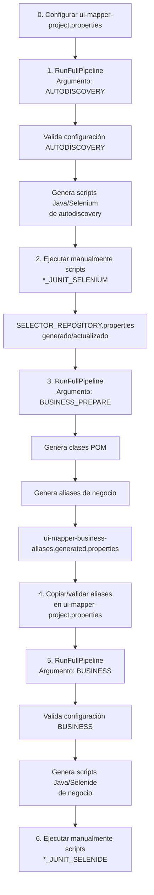

# UI_MAPPER — Pipeline de Generación

## 1. Objetivo

Este documento describe el flujo oficial para generar automatización funcional usando `UI_MAPPER` desde un proyecto consumidor.

El pipeline actual usa el runner:

```text
RunFullPipeline
```

con tres argumentos principales:

```text
AUTODISCOVERY
BUSINESS_PREPARE
BUSINESS
```

---

## 2. Dónde colocar este documento

Este archivo debe colocarse en el proyecto consumidor template en la siguiente ruta:

```text
ui-mapper-consumer-template/
└── docs/
    └── PIPELINE_GENERACION.md
```

También se recomienda referenciarlo desde el `README.md` principal del template.

---

## 3. Pipeline actual



---

## 4. Versión lineal

```text
0. Configurar ui-mapper-project.properties
        │
        ▼
1. RunFullPipeline AUTODISCOVERY
        │
        ▼
2. Ejecutar scripts generados de autodiscovery
        │
        ▼
SELECTOR_REPOSITORY.properties generado/actualizado
        │
        ▼
3. RunFullPipeline BUSINESS_PREPARE
        │
        ▼
POM + aliases generados
        │
        ▼
4. Copiar/validar aliases en ui-mapper-project.properties
        │
        ▼
5. RunFullPipeline BUSINESS
        │
        ▼
Scripts Business generados
        │
        ▼
6. Ejecutar scripts Business generados
```

---

## 5. Detalle de pasos

## Paso 0 — Configurar contrato

Archivo:

```text
src/test/resources/ui-mapper-project.properties
```

Este archivo es el contrato entre el proyecto consumidor y el framework `UI_MAPPER`.

Debe contener la configuración base del proyecto consumidor:

```properties
project.name
project.applicationName
project.moduleName
project.baseUrl
project.pageBase
project.features.directory
project.selector.definitionFile
project.autodesc.packageName
project.autodesc.outputDirectory
project.pom.packageName
project.pom.outputDirectory
project.business.packageName
project.business.outputDirectory
project.business.features.directory
```

También debe incluir, después de la generación de aliases:

```properties
project.business.page.*
project.business.element.*
```

---

## Paso 1 — Ejecutar Autodiscovery

Runner:

```text
RunFullPipeline
```

Argumento:

```text
AUTODISCOVERY
```

Qué hace:

```text
✔ Valida configuración AUTODISCOVERY
✔ Lee features de autodiscovery
✔ Genera scripts Java/Selenium de autodescubrimiento
```

Entrada principal:

```text
src/test/resources/features/autodiscovery/*.feature
```

Salida esperada:

```text
src/test/java/.../*_JUNIT_SELENIUM.java
```

---

## Paso 2 — Ejecutar scripts generados de Autodiscovery

Acción manual:

```text
Ejecutar clases *_JUNIT_SELENIUM
```

Estos scripts abren el navegador, recorren la aplicación y ejecutan las capturas definidas en los `.feature` de autodiscovery.

Resultado:

```text
src/test/resources/selectors/SELECTOR_REPOSITORY.properties
```

Este archivo queda poblado o actualizado con información como:

```text
logicalIds
primary selectors
alternative selectors
type
page
scope
```

Ejemplo conceptual:

```properties
LOGIN.USERNAME_INPUT.primary=css:#username
LOGIN.USERNAME_INPUT.type=INPUT
LOGIN.USERNAME_INPUT.page=login
LOGIN.USERNAME_INPUT.scope=xpath://form
```

---

## Paso 3 — Preparar Business

Runner:

```text
RunFullPipeline
```

Argumento:

```text
BUSINESS_PREPARE
```

Qué hace:

```text
✔ Genera clases POM
✔ Genera aliases de negocio
```

Entradas:

```text
SELECTOR_REPOSITORY.properties
ui-mapper-project.properties
```

Salidas esperadas:

```text
src/test/java/.../pom/*.java
src/test/resources/ui-mapper-business-aliases.generated.properties
```

El archivo:

```text
ui-mapper-business-aliases.generated.properties
```

contiene aliases sugeridos para:

```properties
project.business.page.*
project.business.element.*
```

---

## Paso 4 — Copiar / validar aliases

Acción manual:

Abrir:

```text
src/test/resources/ui-mapper-business-aliases.generated.properties
```

Copiar al contrato:

```text
src/test/resources/ui-mapper-project.properties
```

los bloques:

```properties
project.business.page.*
project.business.element.*
```

Antes de copiar, validar:

```text
✔ Que el PAGE_ALIAS sea claro
✔ Que la clase POM corresponda a la página esperada
✔ Que los elementos estén en la página correcta
✔ Que las secciones/cards tengan sentido
✔ Que los nombres sean útiles para escribir Gherkin
```

Ejemplo de page alias:

```properties
project.business.page.LOGIN=FeaturesAuthLoginPage
```

Ejemplo de element alias:

```properties
project.business.element.LOGIN.logInButton=FEATURES_LAYOUT_AUTH_LOGIN.LOG_IN_BUTTON
```

Uso en Gherkin:

```gherkin
When on page "LOGIN"
And click "logInButton"
```

---

## Paso 5 — Generar scripts Business

Runner:

```text
RunFullPipeline
```

Argumento:

```text
BUSINESS
```

Qué hace:

```text
✔ Valida configuración BUSINESS
✔ Lee features de negocio
✔ Genera scripts Java/Selenide de negocio
```

Entrada principal:

```text
src/test/resources/features/business/*.feature
```

Salida esperada:

```text
src/test/java/.../*_JUNIT_SELENIDE.java
```

---

## Paso 6 — Ejecutar scripts Business

Acción manual:

```text
Ejecutar clases *_JUNIT_SELENIDE
```

Resultado:

```text
Flujos de negocio ejecutados con Selenide
```

Estos scripts ya usan:

```text
POM generadas
SelectorRepository
SelectorValidator
SelectorHealingEngine
Aliases de negocio
```

---

## 6. Resumen de comandos / argumentos

| Etapa | Runner | Argumento | Resultado |
|---|---|---|---|
| Autodiscovery | `RunFullPipeline` | `AUTODISCOVERY` | Scripts Selenium de autodiscovery |
| Ejecutar Autodiscovery | Clases generadas | N/A | `SELECTOR_REPOSITORY.properties` actualizado |
| Preparar Business | `RunFullPipeline` | `BUSINESS_PREPARE` | POM + aliases |
| Copiar aliases | Manual | N/A | Contrato actualizado |
| Generar Business | `RunFullPipeline` | `BUSINESS` | Scripts Selenide de negocio |
| Ejecutar Business | Clases generadas | N/A | Flujos ejecutados |

---

## 7. Acciones manuales obligatorias

Aunque `RunFullPipeline` reduce el número de runners, todavía existen pasos manuales importantes:

| Paso manual | Motivo |
|---|---|
| Ejecutar scripts `*_JUNIT_SELENIUM` | Poblar `SELECTOR_REPOSITORY.properties` |
| Copiar/validar aliases | Confirmar nombres funcionales antes de usarlos en Gherkin |
| Ejecutar scripts `*_JUNIT_SELENIDE` | Ejecutar los flujos de negocio reales |

---

## 8. Flujo operativo oficial

```text
RunFullPipeline AUTODISCOVERY
 → Ejecutar scripts autodiscovery generados
 → RunFullPipeline BUSINESS_PREPARE
 → Copiar/validar aliases
 → RunFullPipeline BUSINESS
 → Ejecutar scripts Business generados
```

---

## 9. Comparación contra runners individuales

Antes, el usuario ejecutaba runners separados:

```text
RunSetupValidation AUTODISCOVERY
RunAutodescubrimiento
RunPomGeneration
RunBusinessAliasGeneration
RunSetupValidation BUSINESS
RunBusiness
```

Ahora, el flujo operativo se reduce a:

```text
RunFullPipeline AUTODISCOVERY
RunFullPipeline BUSINESS_PREPARE
RunFullPipeline BUSINESS
```

con acciones manuales controladas entre etapas.

---

## 10. Buenas prácticas

- Ejecutar `RunFullPipeline AUTODISCOVERY` antes de generar POM.
- No ejecutar `BUSINESS_PREPARE` hasta haber corrido los scripts `*_JUNIT_SELENIUM`.
- No ejecutar `BUSINESS` hasta copiar y validar aliases en `ui-mapper-project.properties`.
- Revisar siempre `ui-mapper-business-aliases.generated.properties` antes de copiar.
- Mantener `ui-mapper-project.properties` ordenado por página.
- Regenerar POM y aliases si cambia el repositorio de selectores.
- Separar claramente features de autodiscovery y features de negocio.
- Usar aliases funcionales y legibles para el DSL Business.

---

## 11. Errores comunes

### Error: no existen features de autodiscovery

Causa:

```text
project.features.directory no existe o no contiene archivos .feature
```

Solución:

Crear archivos `.feature` en:

```text
src/test/resources/features/autodiscovery
```

---

### Error: SELECTOR_REPOSITORY.properties está vacío

Causa:

Se intentó ejecutar `BUSINESS_PREPARE` o `BUSINESS` antes de ejecutar los scripts generados de autodiscovery.

Solución:

Ejecutar manualmente las clases:

```text
*_JUNIT_SELENIUM
```

---

### Error: no existen aliases de página o elementos

Causa:

No se copiaron los aliases generados al contrato.

Solución:

Ejecutar:

```text
RunFullPipeline BUSINESS_PREPARE
```

Luego copiar al contrato:

```properties
project.business.page.*
project.business.element.*
```

---

### Error: elemento no existe en la página actual

Causa:

El feature Business tiene un `When on page "PAGE_ALIAS"` incorrecto para el elemento utilizado.

Solución:

Verificar que el alias del elemento exista bajo el mismo `PAGE_ALIAS` en:

```text
ui-mapper-project.properties
```

Ejemplo correcto:

```properties
project.business.element.LOGIN.logInButton=FEATURES_LAYOUT_AUTH_LOGIN.LOG_IN_BUTTON
```

Uso correcto:

```gherkin
When on page "LOGIN"
And click "logInButton"
```

---

## 12. Resultado esperado del pipeline completo

Al finalizar el flujo completo, el proyecto consumidor debe tener:

```text
✔ SELECTOR_REPOSITORY.properties generado/actualizado
✔ Clases POM generadas
✔ ui-mapper-business-aliases.generated.properties generado
✔ Aliases copiados/validados en ui-mapper-project.properties
✔ Scripts Java/Selenide de negocio generados
✔ Scripts de negocio ejecutables
```

---

## 13. Conclusión

`RunFullPipeline` simplifica el uso operativo de `UI_MAPPER` al reducir varios runners individuales a tres ejecuciones controladas.

El pipeline queda dividido en tres grandes momentos:

```text
Descubrir UI
Preparar artefactos Business
Generar automatización de negocio
```

Este flujo permite que un proyecto consumidor avance desde archivos Gherkin hasta scripts ejecutables de Selenium/Selenide con menos pasos manuales, menor riesgo de error y una estructura más fácil de repetir en nuevos proyectos.
